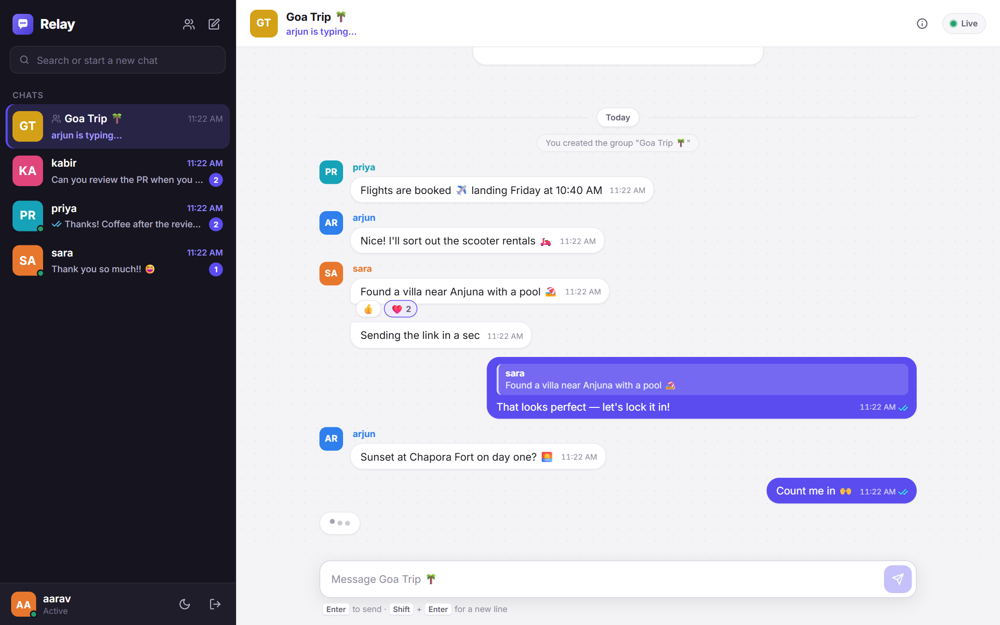
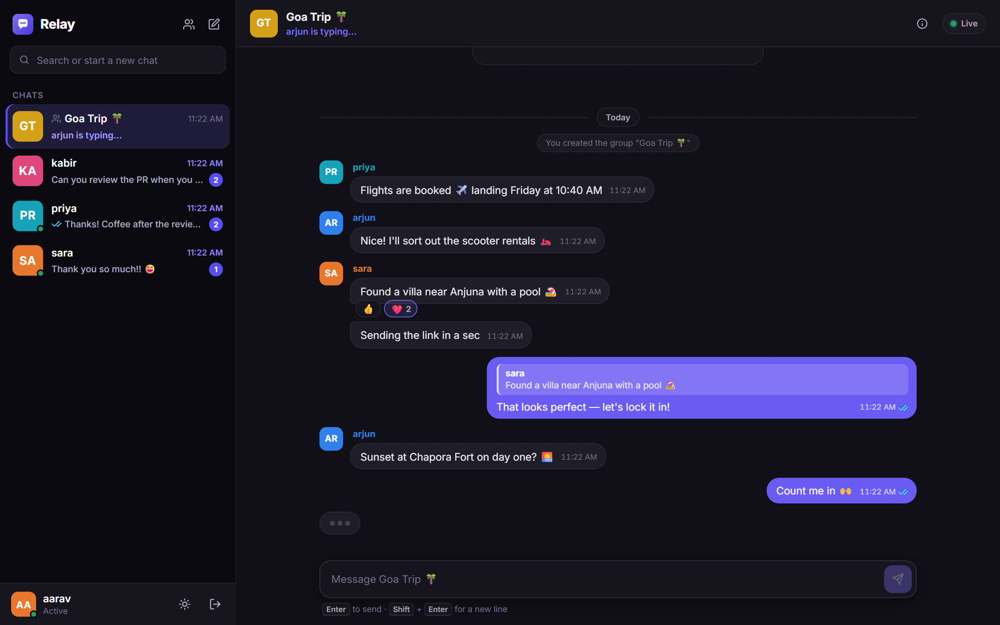
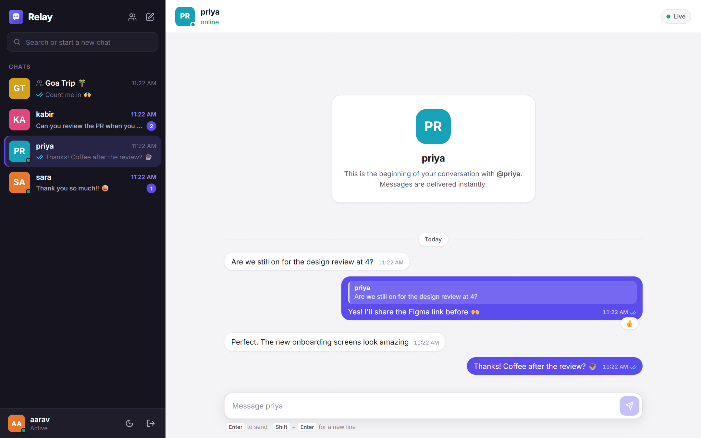
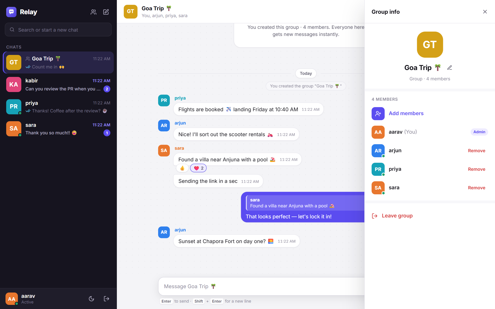
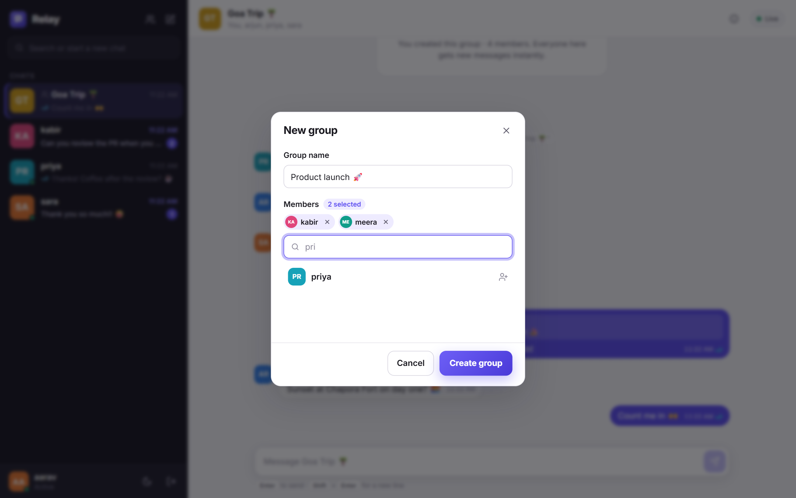
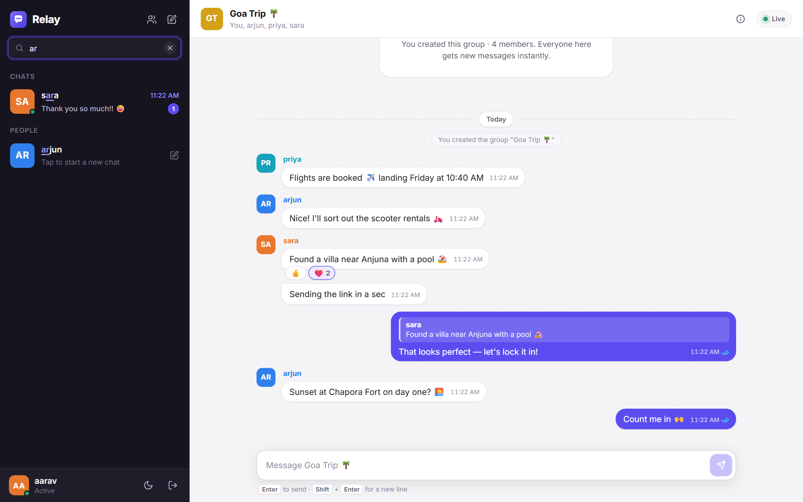
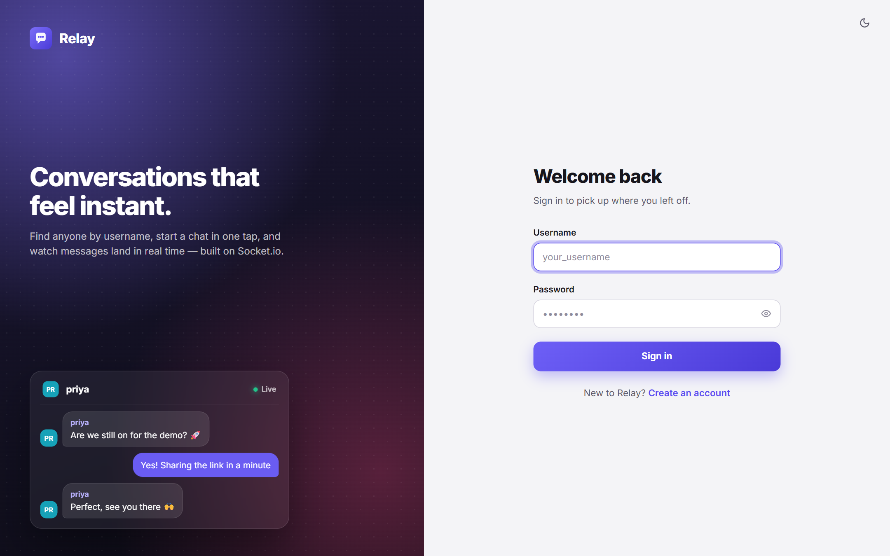
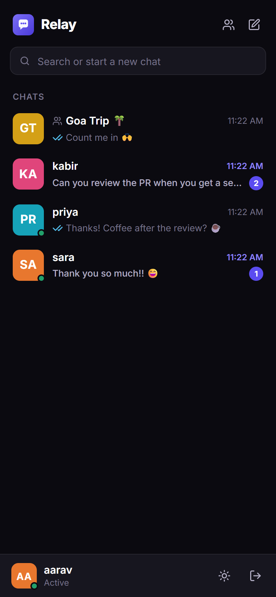
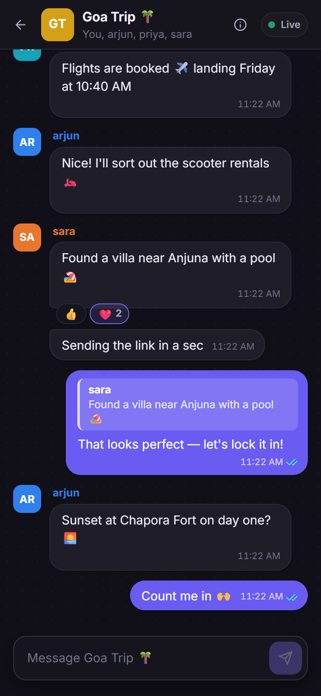
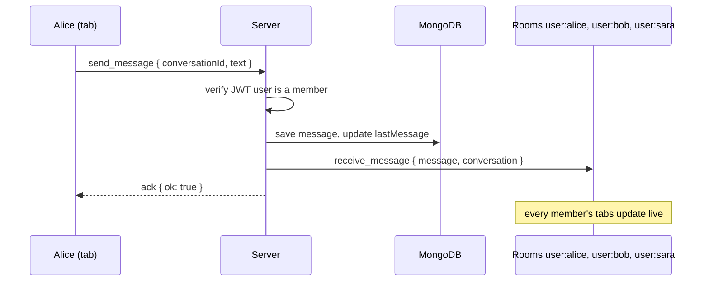

<div align="center">

# 💬 Relay

**A real-time chat app with one-to-one and group conversations, built with React, Node.js, Socket.io and MongoDB.**




</div>

## ✨ Features

- **One-to-one and group chats.** Search anyone by username and start a chat in one tap, or create a group with up to 50 members.
- **Real-time delivery.** Messages, edits and reactions appear instantly on every open tab and device.
- **Read receipts.** ✓ sent, ✓✓ delivered, blue ✓✓ read. In groups, ticks turn blue only when everyone has read.
- **Typing indicators.** "priya is typing…" in the header, the chat list and as an animated bubble.
- **Online presence.** Online dots and "last seen today at 4:20 PM", with no flicker when you refresh.
- **Replies, reactions and delete for everyone.** Quote a message, react with 👍 ❤️ 😂 😮 😢 🙏, or remove a message for both sides. Deleted text is erased from the database.
- **Group admin tools.** Rename the group, add and remove members, and leave. Admin rights pass on automatically when the last admin leaves.
- **Unread counts** that persist across refreshes and stay in sync across your devices.
- **Infinite scroll.** Older messages load as you scroll up, without the view jumping.
- **Polished UI.** Light and dark themes, plus a WhatsApp-style mobile layout.
- **Secure by default.** bcrypt password hashing, JWT auth on both HTTP and the WebSocket handshake, and every permission checked on the server.

## 📸 Screenshots

<table>
  <tr>
    <td width="50%"><p align="center"><b>Group chat</b>: replies, reactions, read receipts</p></td>
    <td width="50%"><p align="center"><b>Dark mode</b></p></td>
  </tr>
  <tr>
    <td><p align="center"><b>Direct messages</b> with online status</p></td>
    <td><p align="center"><b>Group info</b>: members, admins, add and remove</p></td>
  </tr>
  <tr>
    <td><p align="center"><b>Create a group</b> in seconds</p></td>
    <td><p align="center"><b>Search or start a new chat</b></p></td>
  </tr>
  <tr>
    <td colspan="2"><p align="center"><b>Sign in</b></p></td>
  </tr>
</table>

<p align="center">
  
  &nbsp;&nbsp;
  
  <br />
  <b>Mobile</b>: the chat list and an open chat, like WhatsApp
</p>

## 🛠 Tech stack

| Layer | Tech |
|---|---|
| Frontend | React 19, Vite 8, React Router 7, Socket.io client |
| Backend | Node.js, Express 5, Socket.io 4 |
| Database | MongoDB Atlas with Mongoose 9 |
| Auth | JWT (jsonwebtoken) and bcrypt (bcryptjs) |

## ⚙️ How it works

Every connected socket joins a **personal room**, `user:<id>`. A user with three tabs open has three sockets in the same room.

To send a message, the server saves it and emits it to the room of **every current member** of the conversation. Every member, on every tab, gets it instantly, and nobody else does. The member list is read from the database at the moment of sending, so a removed member stops receiving immediately.



HTTP is used for loading data: the chat list, message history and people search. The socket is used for everything live.

<details>
<summary><b>Socket events</b></summary>

| Client → server | Purpose |
|---|---|
| `send_message` | Send a text, optionally as a reply (`replyToId`) |
| `typing` | Start or stop typing (sent as a volatile event) |
| `mark_delivered` / `mark_read` | Move your read receipt forward |
| `react` / `delete_message` | Add or remove a reaction; delete for everyone |
| `watch_presence` | Subscribe to online/last-seen updates for some users |
| `create_group` / `add_members` / `remove_member` / `rename_group` / `leave_group` | Group management (admins only where it applies) |

| Server → client | Purpose |
|---|---|
| `receive_message` | A new message or group update, with the latest conversation |
| `message_updated` | A message changed (reaction or deletion) |
| `receipt` | Someone's delivered/read position moved |
| `typing` | Someone in a chat started or stopped typing |
| `presence` | A watched user came online or went offline |
| `conversation_removed` | You left, or were removed from, a group |

</details>

<details>
<summary><b>REST API</b></summary>

| Method | Endpoint | Description |
|---|---|---|
| `POST` | `/api/auth/register` | Create an account and receive a JWT |
| `POST` | `/api/auth/login` | Sign in and receive a JWT |
| `GET` | `/api/auth/me` | The current user |
| `GET` | `/api/users/search?q=` | Find people by username |
| `GET` | `/api/conversations` | Your chats with unread counts |
| `GET` | `/api/conversations/:id/messages?before=&limit=` | Cursor-paginated message history |

</details>

## 🚀 Getting started

### Prerequisites

- **Node.js 20.19+** (or 22.12+) and npm
- A **MongoDB** database. A free [MongoDB Atlas](https://www.mongodb.com/atlas) cluster works well.

### 1. Clone

```bash
git clone https://github.com/nitish331/socket-io-chat.git
cd socket-io-chat
```

### 2. Configure the server

Copy `server/.env.example` to `server/.env` and fill it in:

```env
PORT=5000
CLIENT_URL=http://localhost:5173
MONGO_URI=mongodb+srv://<username>:<password>@<cluster>.mongodb.net/chat_app?retryWrites=true&w=majority
JWT_SECRET=<a long random string>
JWT_EXPIRES_IN=7d
```

Generate a strong `JWT_SECRET` with:

```bash
node -e "console.log(require('crypto').randomBytes(48).toString('hex'))"
```

> In Atlas, make sure your current IP address is allowed under **Network Access**.

### 3. Run the server

```bash
cd server
npm install
npm run dev
```

You should see `MongoDB connected` and `Server listening on http://localhost:5000`.

### 4. Run the client

In a second terminal:

```bash
cd client
npm install
npm run dev
```

Open **http://localhost:5173**, create an account, and open a private window with a second account to chat with yourself.

## 📁 Project structure

```
.
├── client/                     React + Vite frontend
│   └── src/
│       ├── auth/               Auth context and route guards
│       ├── components/
│       │   ├── auth/           Login/register layout
│       │   └── chat/           Sidebar, MessageList, Composer, GroupInfoPanel, …
│       ├── pages/              Chat, Login, Register and their styles
│       ├── utils/              Formatting, receipts and reactions helpers
│       └── socket.js           The shared Socket.io client
├── server/                     Express + Socket.io backend
│   ├── models/                 User, Conversation, Message
│   ├── routes/                 auth, users, conversations (REST)
│   ├── socket/                 chat, groups, receipts, presence, message actions
│   ├── middleware/auth.js      JWT checks for HTTP and socket connections
│   └── index.js                App entry point
└── screenshot/                 Images used in this README
```

## 🗺 Roadmap

- [ ] Image and file sharing
- [ ] Browser notifications and sounds
- [ ] Message editing
- [ ] Scaling across multiple server instances with the Socket.io Redis adapter
